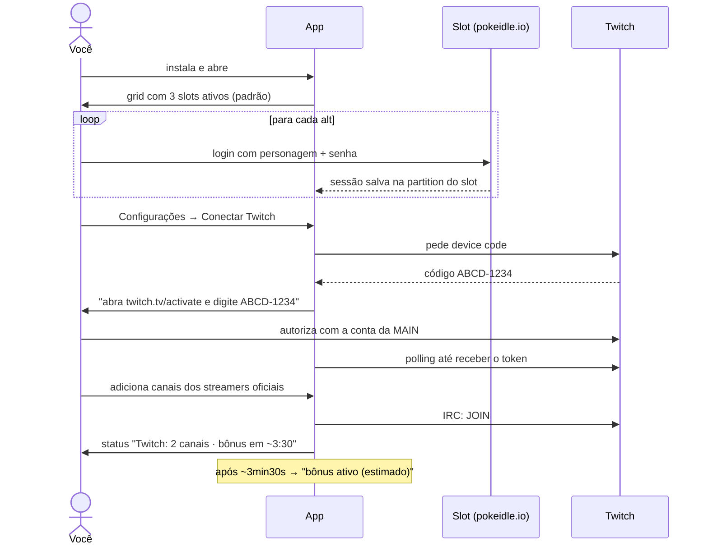
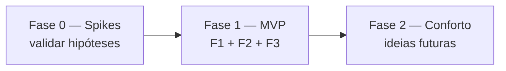

# Deck Chat — PRD

> App desktop pessoal (Windows) que junta várias contas do PokeIdle numa janela, no estilo IdleDeck, e mantém a conta principal presente nos chats da Twitch dos streamers oficiais, no estilo Chatterino, mas sem interface de chat.

| | |
|---|---|
| Status | Rascunho v2 — escopo fechado para o MVP |
| Dono | gbr |
| Plataforma alvo | Windows 10/11 (PC secundário). Desenvolvimento no Linux |
| Doc técnico | [TECHNICAL.md](./TECHNICAL.md) |
| Visual | [show-me-prd.html](./show-me-prd.html) |

---

## 1. Problema

Hoje, para deixar as alts do PokeIdle rodando e ainda ganhar o bônus de streamer na main, é preciso:

- abrir **um navegador ou perfil diferente por conta**, porque o login fica em cookie e localStorage e duas abas do mesmo navegador compartilham a sessão;
- manter **abas da Twitch abertas** só para a main "estar no chat". Isso consome um player de vídeo inteiro sem necessidade;
- lembrar de reabrir tudo quando o PC reinicia ou o navegador trava.

## 2. Objetivo

Um único app que:

1. Mostra **até 4 contas do PokeIdle ao mesmo tempo** num grid automático, cada uma com sessão isolada, como se estivesse num navegador diferente.
2. Mantém a **conta Twitch da main conectada ao chat** de uma lista de streamers da forma mais leve possível: sem vídeo, sem UI de chat, só presença.
3. Roda 24/7 de forma confiável: inicia com o Windows, fica na bandeja, reconecta e recarrega sozinho.

### Fatos confirmados

| Fato | Valor |
|---|---|
| URL do jogo | `https://pokeidle.io` |
| Tempo até o bônus ativar após entrar no chat | **~3min30s** com navegador normal · **3min40s** com IRC puro (S1, 26/10/2026, canal aXtLOL) |
| IRC sem vídeo conta como presença? | **Sim**, validado no S1 |
| Tempo até o bônus sumir após sair do chat | **< 5 min**, então a reconexão precisa ser rápida |
| Bônus de vários canais | **Acumula**: vale estar em todos os oficiais ao mesmo tempo |
| Bônus com o streamer offline | **Não conta**: só quando ele está ao vivo |
| Bônus depende da máquina/IP? | **Não**: o S1 rodou num notebook Linux e o bônus ativou no jogo aberto no PC Windows. É por conta |
| Tempo usado pelo app para "bônus ativo (estimado)" | **4:00** (folga sobre os 3:40 medidos) |
| Autorizar o app desloga a Twitch? | **Não**. No S1, o que derrubou a sessão web do PC Windows foi o **login novo no site** feito no notebook. O token do app não afeta sessões do navegador |
| Lista de streamers oficiais | **Enviada pelo servidor** no WebSocket (`estado.twitch.oficiais`, 16 canais em 28/10), junto com quem está ao vivo (`twitch.lives`). Não aparece na aba Network como requisição separada, por isso parecia fixa |

### Fora do escopo (decidido)

| Item | Motivo |
|---|---|
| ~~Kick~~ | Revisto na Fase 2 (03/11/2026): pontos e bônus da Kick viraram o spike S6. O bônus é por pontos de canal ganhos **assistindo**, então o custo é RAM, e assistir sem estar presente pode ir contra os termos da Kick (risco aceito) |
| Ler ou enviar mensagens de chat | Não é o objetivo. A presença basta |
| Automação de gameplay (cliques, bots, macros) | Risco de ban. O app só **exibe** o jogo |
| Proxy ou IP por conta | O limite do jogo é 4 contas por IP, e o app respeita isso por design (máx. 4 slots) |
| ~~Auto-update~~ | Revisto na Fase 2 (03/11/2026): o repo virou público (licença MIT) e a atualização automática entrou como F9 |
| macOS e Linux como alvo | Só Windows. Linux é só ambiente de desenvolvimento |

## 3. Contexto de uso

```text
PC secundário (Windows)
  Deck Chat
    slot-1  alt A   (ativo)
    slot-2  alt B   (ativo)
    slot-3  alt C   (ativo)
    slot-4  —       (reservado; pode virar a main no futuro)
    TwitchPresence  → conta Twitch da MAIN em N canais
```

- As **contas do jogo** fazem login com **nome do personagem + senha**, direto no site, dentro do slot.
- A **conta Twitch** usada é sempre a da **main**, que é a vinculada no PokeIdle para receber o bônus.
- Hipótese de funcionamento do bônus: os streamers oficiais dão mod ao dev do PokeIdle, que consulta a lista de quem está conectado no chat (Twitch *Get Chatters*). Por isso a presença no chat deve bastar. **Isso precisa ser validado na Fase 0.**

## 4. Funcionalidades do MVP

### F1 — Slots de conta (grid automático)

| ID | Requisito |
|---|---|
| F1.1 | 4 slots fixos (`slot-1`…`slot-4`), cada um ativável e desativável nas configurações |
| F1.2 | Cada slot tem **sessão persistente e isolada** (cookies, localStorage, IndexedDB e cache separados) |
| F1.3 | Login feito no próprio site. Fechar e reabrir o app mantém o login |
| F1.4 | Grid automático conforme o número de slots ativos (1 → 1×1, 2 → 2×1, 3–4 → 2×2) |
| F1.5 | Cada slot tem um rótulo editável (ex.: "Alt A — Charizard") |
| F1.6 | Barra por slot com **mutar/desmutar**, **recarregar** e indicador de estado |
| F1.7 | O jogo **não desacelera** com a janela minimizada, na bandeja ou sem foco (throttling de segundo plano desativado) |
| F1.8 | Se a página do slot travar ou o processo cair, o app recarrega sozinho e registra o evento |
| F1.9 | URL do jogo configurável (padrão `https://pokeidle.io`) |
| F1.10 | Os slots **continuam rodando** enquanto a aba ou um modal de configurações estiver aberto |
| F1.11 | **Vigia de saúde**: o jogo é controlado pelo servidor e recebe ~60–90 mensagens/min por alt (S3). Se um slot ficar **3 min sem receber nada**, ele vai para o status `sem resposta` e é recarregado sozinho. A barra do slot mostra `eventos/min` |
| F1.12 | A barra de cada slot mostra os dados da alt vindos do jogo: **nick** (no lugar de "Alt A") e **nível e hunt atual** (`Nv 44 · charmander`). As pokébolas não aparecem na barra; são usadas só para o aviso "acabaram as pokébolas" (F5.2) |

### F2 — Presença na Twitch (main)

| ID | Requisito |
|---|---|
| F2.1 | Login da main via **Device Code Flow**: o app mostra um código e abre `twitch.tv/activate` **no navegador padrão do Windows**, onde você já está logado, e você só autoriza. **Nunca** abrir o login da Twitch numa janela própria do app: isso conta como dispositivo novo e pode derrubar a sessão do navegador (observado no S1) |
| F2.2 | Token salvo **criptografado** (DPAPI do Windows via `safeStorage`) e renovado automaticamente |
| F2.3 | **Lista de canais importada do jogo**: o servidor envia `estado.twitch.oficiais` a cada ~67s (S4). O app sincroniza sozinho e guarda a última lista na config, para o IRC já entrar nos canais ao abrir, antes dos slots carregarem. Também é possível adicionar **canais extras manuais** e desligar qualquer canal |
| F2.4 | Uma única conexão IRC (WebSocket) entra em todos os canais ativos. Nada de vídeo nem UI de chat |
| F2.5 | Reconexão automática **rápida**: o bônus some em < 5 min. Inclui PING próprio a cada 60s (sem PONG em 10s → reconecta), reconexão imediata ao voltar do sleep, backoff de no máximo 60s e reentrada nos canais |
| F2.6 | Estado por canal: `entrando` → `presente · bônus em 4:00` (contagem regressiva) → `bônus ativo (estimado)`, ou `erro`. O app não enxerga o bônus de fato, só estima pelo tempo desde o `JOIN` |
| F2.8 | Opção "impedir suspensão do Windows" enquanto o app estiver aberto (`powerSaveBlocker`) |
| F2.9 | **Detecção de ao vivo pelo próprio jogo**: `estado.twitch.lives` traz os oficiais ao vivo e o número de espectadores. Sem consultar a API da Twitch. O horário em que o canal aparece como ao vivo conta como "início da live" para o F2.10. Canais extras manuais aparecem como "ao vivo: desconhecido" |
| F2.10 | O bônus só conta ao vivo e **acumula** entre canais, então o app fica sempre no chat de todos os canais ativos (offline não custa nada). O bônus estimado de cada canal é `max(JOIN, início da live) + 4:00` |
| F2.11 | A barra superior resume o estado, por exemplo `Twitch: 3/7 ao vivo · 3 bônus`. Notificação no tray quando a conexão cai por mais de 30s |
| F2.7 | Botão "Sair da Twitch" (revoga e apaga o token) |

### F3 — Sistema e operação

| ID | Requisito |
|---|---|
| F3.1 | **Minimizar para a bandeja**: fechar a janela ou "minimizar" esconde o app em vez de encerrar. Menu do tray: Mostrar / Status / Sair. **A janela nunca fica no estado minimizado do Windows**, porque nele os slots caem para 1 fps (S3). O botão nativo de minimizar é desativado e substituído por "⤓ Bandeja" |
| F3.2 | **Iniciar com o Windows** (opção), podendo já iniciar escondido na bandeja |
| F3.3 | **Indicador de status** global na barra superior: Twitch (conectado, com nº de canais e bônus estimado) e slots (ok, recarregando, erro) |
| F3.4 | ~~Atualização manual~~ → automática desde a v0.1.3 (F9). A aba Sobre mostra a versão instalada e o estado da atualização; as sessões e a config são preservadas |
| F3.5 | Janela lembra tamanho, posição e monitor |

### F5 — Notificações das alts

| ID | Requisito |
|---|---|
| F5.1 | **Aba "Notificações"**: linha do tempo única com os eventos de todas as alts, mostrando horário, alt, ícone do tipo e descrição |
| F5.2 | Tipos (formato confirmado no S4):<br>• **Shiny** capturado / fugiu (`capturado.pokemon.shiny`, `bola.shiny`, `fugiu.shiny`) e apareceu (hipótese: `spawn.looktype` 7xxxx), com destaque<br>• **Drop**: todo item de `morte.drops` (stones nas hunts normais; boss token, fragmentos e stones nas outlands). Sem lista de raros<br>• **Captura**: toda captura, com os dados do Pokémon (nome, nível, quality, potência, IVs). Sem filtro de raridade<br>• **Problemas**: sem pokébola (`estado.balls`), foi ao Centro Pokémon (`noCentro`/`centroMotivo`), sem resposta (F1.11) |
| F5.3 | Filtro por alt e por tipo |
| F5.4 | Fonte: leitura **passiva** das mensagens WebSocket que o servidor envia a cada slot (o mesmo canal do F1.11). Nada é enviado ao jogo |
| F5.5 | Histórico **só da sessão atual** (em memória). Fechar o app limpa a lista |
| F5.6 | Sem notificação do Windows: só a aba, com um contador de não lidas no título da aba |
| F5.7 | O formato das mensagens é descoberto no spike **S4**. O parser fica isolado (`src/main/game/`), porque pode quebrar quando o jogo atualizar. Mensagens não reconhecidas são ignoradas e registradas no log |

### F4 — Configurações

| ID | Requisito |
|---|---|
| F4.1 | **Aba "Configurações"** separada da aba "Contas", em tela cheia. Ao entrar nela, as views dos slots são escondidas, mas os jogos continuam rodando |
| F4.2 | **Modal rápido** para ações curtas (ex.: adicionar canal, renomear slot). Ao abrir, o app tira um print de cada slot, esconde as views e mostra os prints desfocados de fundo, com o modal por cima. Visualmente parece um overlay sobre os jogos |
| F4.3 | Fechar a aba ou o modal devolve os slots exatamente como estavam |

## 5. Fluxos principais

### 5.1 Primeiro uso



### 5.2 Operação diária

```text
Windows liga
  Deck Chat inicia escondido na bandeja
    restaura slots ativos     → as sessões já estão logadas
    valida/renova token Twitch
    conecta IRC → JOIN nos canais ativos
  você só abre a janela quando quiser olhar as contas
```

### 5.3 Atualização

```text
você faz git tag v0.2.0 && git push --tags
  GitHub Actions (windows-latest) gera Deck-Chat-Setup-0.2.0.exe + latest.yml
  publica num Release do repo (público desde a v0.1.3)
no PC Windows (a partir da v0.1.3, F9)
  o app confere a cada 6 h, baixa sozinho e mostra "⬆ Atualizar para 0.2.0 e reiniciar"
  um clique: fecha, instala em silêncio na mesma pasta e abre de novo
  config, tokens e sessões dos slots ficam em %APPDATA% → nada se perde
zip portátil: continua manual (baixar nos Releases)
```

## 6. Interface (wireframe)

```text
┌──────────────────────────────────────────────────────────────────────┐
│ Deck Chat  [Contas] [Configurações]  ● Twitch 3/7 ao vivo · 3 bônus  │
├───────────────────────────────────┬──────────────────────────────────┤
│ Alt A            🔊 ⟳  ● ok       │ Alt B            🔇 ⟳  ● ok      │
│                                   │                                  │
│          [ pokeidle.io ]          │          [ pokeidle.io ]         │
│                                   │                                  │
├───────────────────────────────────┼──────────────────────────────────┤
│ Alt C            🔇 ⟳  ● ok       │ Slot 4 — desativado              │
│                                   │                                  │
│          [ pokeidle.io ]          │      [ + ativar slot ]           │
│                                   │                                  │
└───────────────────────────────────┴──────────────────────────────────┘
```

A aba **Configurações** ocupa a tela inteira (os slots ficam escondidos, mas rodando):

```text
Configurações
├── Slots        # ativar/desativar, rótulo, URL do jogo, limpar sessão do slot
├── Twitch       # conectar/desconectar main, lista de canais (+ toggle), status por canal
├── Sistema      # iniciar com Windows, iniciar escondido, fechar → bandeja
└── Sobre        # versão instalada, link para os Releases, abrir pasta de logs
```

Já o **modal rápido** aparece sobre a aba Contas, com os prints desfocados dos slots de fundo:

```text
┌──────────────────────────────────────────────────────────────────────┐
│ ░░░░░░░░ print desfocado ░░░░░░░░ │ ░░░░░░░░ print desfocado ░░░░░░░ │
│ ░░░░░░░ ┌──────────────────────────────────────────┐ ░░░░░░░░░░░░░░ │
│ ░░░░░░░ │ Adicionar canal Twitch                   │ ░░░░░░░░░░░░░░ │
│ ░░░░░░░ │ [ streamer_oficial_3        ]  [Salvar]  │ ░░░░░░░░░░░░░░ │
│ ░░░░░░░ └──────────────────────────────────────────┘ ░░░░░░░░░░░░░░ │
│ ░░░░░░░░░░░░░░░░░░░░░░░░░░░░░░░░░ │ ░░░░░░░░░░░░░░░░░░░░░░░░░░░░░░░░ │
└──────────────────────────────────────────────────────────────────────┘
```

## 7. Requisitos não funcionais

| Área | Requisito |
|---|---|
| Confiabilidade | Rodar dias seguidos sem intervenção. Reconexão do IRC e recarga dos slots automáticas |
| Desempenho | A presença na Twitch deve custar ~0 (1 WebSocket). O custo do app é dominado pelos slots (~200–400 MB de RAM cada, estimado) |
| Segurança | Slots sem acesso a Node, `contextIsolation` + `sandbox`. Token criptografado. IPC validado com schemas |
| Privacidade | Nenhuma telemetria. Logs só locais |
| Distribuição | Instalador `.exe` (NSIS) gerado pelo GitHub Actions e publicado nos Releases do próprio repo (público, MIT). Atualização automática desde a v0.1.3 |

## 8. Roadmap



### Fase 0 — Validação (antes de construir a UI)

| Spike | Pergunta | Critério de sucesso |
|---|---|---|
| S1 — Presença IRC ✅ | Uma conexão IRC autenticada (sem vídeo) ativa o bônus de streamer na main? | **Validado em 26/10/2026**: o bônus ativou em 3:40 após o `JOIN`, com 0 reconexões. Ao parar o script, o bônus demorou um pouco para sumir. Ver `spikes/s1-twitch-presence/README.md` |
| S2 — Slot isolado ✅ | O pokeidle.io funciona dentro do Electron com partitions separadas? (login, sem bloqueio de Cloudflare/UA) | **Validado em 27/10/2026** no Windows: 3 alts logadas, sessões mantidas após reiniciar, slot 4 isolado, ~715 MB de RAM com 3 slots |
| S3 — Segundo plano ✅ | Com o throttling desativado, o jogo continua progredindo com o app minimizado ou na bandeja? | **Validado em 27/10/2026.** Rodada 1: minimizada → 1 fps, então o minimizar nativo foi trocado por "esconder na bandeja". Rodada 2: sem foco, bandeja e coberta tiveram fps, timers e atividade de rede iguais, e o "tempo para upar" caiu em ritmo constante. O jogo é controlado pelo servidor (cliente envia ~2.4 msgs/min). Ver `spikes/s2-s3-slots/README.md` |
| S4 — Eventos do jogo ✅ | Como o servidor descreve drops, shinies, capturas e problemas nas mensagens WebSocket? | **Validado em 28/10/2026**: JSON texto com tipo em `t` (`batalha`, `estado`, `chat`, `shiny.captura`…). Drops, capturas, shiny e munição mapeados. **Bônus:** o jogo envia a lista oficial de streamers e quem está ao vivo. Ver `spikes/s4-ws-events/README.md` |

> Se o S1 falhar, o plano B é carregar o popout de chat oficial (`twitch.tv/popout/<canal>/chat`) numa partition escondida da main. É mais pesado, mas igual a um navegador.

### Fase 1 — MVP

Ordem sugerida: ~~casca Electron + Svelte → slots (F1)~~ (feito na Fase 0) → ~~limpar os spikes + vigia de saúde (F1.11, F1.12)~~ (v0.0.4) → ~~aba/modal de configurações (F4)~~ (v0.0.5) → ~~Twitch (F2)~~ (v0.0.6) → ~~Notificações (F5)~~ (v0.0.7) → ~~tray/auto-start/status (F3) → CI gerando o `.exe` nos Releases~~ (v0.1.0). **Fase 1 concluída.**

### Fase 2 — Melhorias após uso da v0.1.0 (31/10/2026)

Contexto do PC Windows que define as prioridades: **16 GB de RAM** divididos com outros programas, enquanto CPU (Ryzen 7 9800X3D, 8 núcleos/16 threads) e GPU (16 GB de VRAM) sobram. **RAM é o recurso a economizar**; trocar RAM por CPU/GPU é aceitável.

Ordem combinada: B1 → S5 → F6 → (F7/F8 conforme o S5). Os itens 5 (snipe no mercado) e 6 (Kick) ficam para depois e serão discutidos à parte.

Discussão de 03/11/2026: atualização automática (F9) e os spikes S6 (Kick) e S7 (Mercado) entram na v0.1.3. O snipe fica em espera; no lugar dele, um comparador de preços e uma calculadora, só de leitura.

#### B1 — Bug: "Iniciar escondido na bandeja" abre a janela

| | |
|---|---|
| Sintoma | Com "Iniciar com o Windows" + "Iniciar escondido" ligados, o app abre com a janela visível no boot |
| Causa provável | `win.maximize()` ao restaurar o estado salvo **também mostra a janela** (comportamento documentado do Electron). Acontece se o app estava maximizado ao fechar |
| Correção | Aplicar o maximizado só quando a janela for mostrada (ao abrir normal ou ao sair da bandeja pela primeira vez) |
| Diagnóstico | Registrar no `deck.log` os argumentos recebidos (`--hidden` sim/não), para confirmar que o Windows repassa o argumento |
| Status | Corrigido na v0.1.1. Causa reproduzida isoladamente (janela escondida + `maximize()` → visível). O `deck.log` da v0.1.0 confirma que o Windows repassa o `--hidden` (boots de 29 e 30/10 registram "na bandeja"). Falta confirmar no boot do Windows |
| Ajuste (v0.1.2) | Sem o `maximize()` precoce, a janela passou a depender só do evento `ready-to-show`, que no Linux/Wayland às vezes não dispara (a janela não aparecia). Plano B: se o evento não vier em 3 s, a janela é exibida mesmo assim (exceto com `--hidden`) |

#### B2 — Bug: o vigia fica parado se o jogo não volta após recarregar

| | |
|---|---|
| Sintoma | 29/10, 17:04 (horário local): atualização da infraestrutura do servidor do jogo. O vigia recarregou os 3 slots, as páginas voltaram sem título e **nenhuma mensagem chegou por 67 min**, até reiniciar o app |
| Causa | O vigia só volta a agir depois da primeira mensagem do jogo; se o jogo não volta, ele nunca tenta de novo |
| Correção (v0.1.2) | Depois de um recarregamento do vigia, enquanto não chegar nenhuma mensagem, recarrega de novo em 3, 6, 12 e depois a cada 15 min. A barra do slot e o cartão do modo foco mostram "sem resposta · nova tentativa às HH:MM". Limpar a sessão ou desativar o slot encerra as tentativas (na tela de login o jogo não manda mensagens) |

#### F6 — Modo foco: um slot ocupa o grid

| ID | Requisito |
|---|---|
| F6.1 | Botão ⛶ na barra de cada slot (e duplo clique na barra) coloca o slot em foco: ele ocupa toda a área do grid; a barra de cima do app continua |
| F6.2 | Os outros slots ficam **escondidos e rodando** (mesmo mecanismo da aba Configurações; S3: escondido não desacelera) |
| F6.3 | Coluna lateral estreita com um cartão por alt fora do foco: nick, Nv, hunt, status (ok/erro) e o último evento. Clicar num cartão troca o foco para aquela alt |
| F6.4 | `Esc` ou o botão ⛶ de novo voltam ao grid. O foco não é salvo entre execuções |
| Status | Entregue na v0.1.1. O `Esc` só funciona com o teclado na interface do app: com o jogo em foco no teclado, a tecla vai para o jogo (que pode usá-la para fechar janelas internas). Nesse caso, sair pelo ⛶ ou por um cartão |

#### S5 — Medição de memória (spike, antes de F7 e F8)

**Pergunta:** quanto de RAM cada processo usa (UI, GPU, cada slot) e quanto cada opção economiza de verdade?

| Fase | Situação | O que mede |
|---|---|---|
| A | Normal (jogo visível) | Linha de base |
| B | Opção do próprio jogo que esconde o canvas e mostra as estatísticas | Se o modo nativo do jogo reduz RAM |
| C | View do slot escondida pelo app (tela preta no lugar do jogo) | Se esconder a view reduz RAM |
| D | Aceleração por GPU desligada (exige reiniciar) | Troca de RAM do processo de GPU por CPU |
| E | Uma noite rodando | Se a memória do jogo cresce com o tempo (vazamento) e quanto um recarregar devolve |

**Resultado (01/11/2026, Windows, v0.1.1)** — medianas da memória privada; análise completa em `spikes/s5-memory/README.md`:

| Fase | Total | Processo de GPU | Slots (cada) |
|---|---|---|---|
| A normal | 2166 MB | 995 MB | 304–335 MB |
| B opção do jogo (esconde o canvas) | 1946 MB (−220) | 827 MB | 309–328 MB |
| C 🙈 do app (tela preta) | 2101 MB (−65, variação) | 997 MB | 269–343 MB |
| D GPU desligada | **1372 MB (−800)** | 27 MB | 359–387 MB |
| E noite (9 h) | slots ~350 → ~470 MB cada | estável ~868 MB | +13 a +30 MB/h |

Conclusões:
- O processo de GPU do Chromium é ~40% da memória do app e não diminui na bandeja. Desligar a aceleração economiza ~800 MB privados (−360 MB em working set), e o jogo ficou normal (sem travamento perceptível, CPU sobra).
- Esconder o jogo pelo app não economiza: a página continua rodando com a mesma memória.
- Os slots crescem com as horas; recarregar devolve a memória.
- O código do app em si é pequeno (main ~95 MB, interface ~50 MB).

#### F7 — Modo baixo consumo por slot: **cancelado**

O S5 mostrou que esconder o jogo (tela preta) não reduz a RAM. O botão 🙈 saiu na v0.1.2. Para ver as estatísticas sem o canvas, o jogo já tem a própria opção, que ainda economiza ~220 MB de GPU.

#### F8 — Redução de memória (v0.1.2)

| ID | Requisito |
|---|---|
| F8.1 | **GPU desligada por padrão.** Config migrada para a versão 2: quem já tinha a opção salva também passa a desligada (uma única vez). Religar continua em Sistema > Desempenho (vale após reiniciar) |
| F8.2 | **Recarregar slot por limite de memória**: ligado por padrão, limite de 500 MB de memória privada por slot (ajustável de 300 a 2000 MB em Sistema > Desempenho). Um slot por vez (5 min entre recarregamentos), no máximo 1x por hora cada, só slot carregado e respondendo, e nunca um slot na tela com a janela em foco (você pode estar usando). Registrado no `deck.log` |
| F8.3 | O medidor do S5 fica no app: tabela em Sobre (a cada minuto) e histórico em `logs/memory.csv` (uma amostra a cada 10 min; acima de 5 MB vira `memory.old.csv`) |

Descartados: esconder o canvas por CSS (o 🙈 não economizou) e corretor ortográfico (ganho irrelevante perto dos números acima).

#### F9 — Atualização automática (v0.1.3)

| ID | Requisito |
|---|---|
| F9.1 | Repo público com licença MIT, para o `electron-updater` ler os Releases sem token |
| F9.2 | Só o app instalado (NSIS) se atualiza. O zip portátil e o modo de desenvolvimento não |
| F9.3 | Confere 1 min após abrir e a cada 6 h; baixa em segundo plano (só a diferença, via blockmap) |
| F9.4 | Versão baixada: botão **"⬆ Atualizar para X e reiniciar"** na barra de cima, linha no menu da bandeja e seção **Atualização** em Sobre (com "Verificar agora"). Sair pelo menu da bandeja também instala |
| F9.5 | Instala em silêncio na mesma pasta e reabre o app. A primeira versão com o atualizador (v0.1.3) ainda é instalada à mão |

**Assinatura de código (decidido: sem assinatura).** O aviso do Windows é o SmartScreen, que aparece para executáveis com pouca reputação. Desde 2024 nenhum certificado o remove no primeiro dia (nem o EV). O Azure Artifact Signing (US$ 9,99/mês) não aceita pessoa física fora dos EUA e do Canadá; um certificado OV custa ~US$ 130–300/ano e exige chave em hardware. Com a atualização automática, o aviso só aparece na primeira instalação: os arquivos baixados pelo próprio app não recebem a marca "veio da internet".

**Validado em 04/11/2026 (v0.1.3 → v0.1.4, Windows):** baixou sozinha, mostrou o aviso e, ao clicar em "Atualizar e reiniciar", o app reiniciou já na versão nova. O dono relatou que tudo funcionou, sem mencionar aviso do Windows.

#### S6 — Pontos da Kick (spike, antes do farm e do resgate de bônus)

Referência: o Kickterino (open source, MIT) mantém 2 lives em janelas invisíveis, em 160p, consulta saldo pela API interna da Kick de dentro de uma página em kick.com, faz rodízio para chegar perto dos bônus e só **avisa** (o resgate é manual). Ele mediu que a Kick conta ~2 lives por conta (somando celular e TV) e +10 pts a cada ~5–6 min por live, após ~7 min de aquecimento (~240 pts/h no total).

O que o jogo manda (`estado.kick`): `oficiais` (slug, nome, `aoVivo`, espectadores, `ativo`): a **lista dinâmica**, já com quem está ao vivo; `recompensas` (XP 300, Captura 500, Shiny 1000 pts); `pct` 15 e `minutos` 60; `bonus` por tipo; `vinculado` e `login`. Os bônus **somam tempo**: 3 resgates de XP = 180 min com os mesmos +15%, então resgatar com bônus ativo não desperdiça pontos.

Perguntas do S6: uma live escondida dentro do app conta pontos? E sem vídeo, ou só com o chat? O limite é mesmo 2 lives? Quanta RAM cada live custa? Como é o resgate (endpoint) e o formato de `kick.bonus`?

| Fase | Configuração |
|---|---|
| K1 | 2 lives, página completa em 160p, janelas escondidas |
| K2 | 2 lives, página sem vídeo (pedidos de vídeo bloqueados) |
| K3 | 4 lives, com vídeo (K3a) ou sem vídeo (K3b), para validar o limite |
| K4 | Plano B do Kickterino: 2 lives em janela transparente |
| K5 | Só o chat popout de 2 canais, sem player (a mais leve) |
| R | Resgate manual de um bônus pela "Loja ↗" (chat popout), com a rede gravada |

Ferramenta (só na v0.1.3; a v0.1.4 troca pelo farm do F10, aba Configurações > Kick (teste)): login da Kick numa sessão separada (`persist:kick`), seletor de fase, tabela dos oficiais com saldo, ganho na fase e memória, e o bloco `kick` de cada slot. Arquivos em `logs/`: `s6-kick.csv` (por minuto: canal, ao vivo, aberta, pontos, ganho, estado do player, memória), `s6-kick-game.jsonl` (bloco `kick` do jogo a cada mudança) e `s6-kick-net.jsonl` (pedidos à API da Kick feitos na Loja, sem cabeçalhos). Protocolo em `spikes/s6-kick/README.md`.

Prévia no Linux, sem login (não mede pontos): escondida, a live toca em 160p e o tempo do vídeo avança. Memória (working set) por canal: ~285 MB com vídeo (K1), ~280 MB sem vídeo (K2: o peso é a página, não o vídeo) e ~210 MB só com o chat (K5). A página de consultas usa ~90 MB.

**Resultado (04/11/2026, Windows, v0.1.3, conta principal):**

| Fase | Lives abertas | Pontos no período (~40 min) | pts/h | Memória privada por live |
|---|---|---|---|---|
| K1 · vídeo 160p, escondidas | 2 | +130 | ~195 | ~234 MB |
| K2 · sem vídeo | 2 | 0 | 0 | ~215 MB |
| K3a · vídeo 160p, escondidas | 4 | +130 (só 2 das 4 ganharam) | ~197 | ~253 MB |
| K3b · sem vídeo | 4 | 0 | 0 | ~240 MB |
| K4 · vídeo, janela transparente | 2 | +140 | ~214 | ~262 MB |
| K5 · só o chat | 2 | 0 | 0 | ~122 MB |

Conclusões:
- **Live escondida dentro do app conta pontos**, com a GPU desligada. A janela transparente do Kickterino não é necessária.
- **Precisa do vídeo tocando.** Sem vídeo ou só com o chat não entra nenhum ponto.
- **O limite de 2 lives se confirma**, e abrir mais só gasta memória. Não dá para escolher quais 2 contam (no K3a ganharam a 2ª e a 3ª abertas).
- Ritmo medido: +10 a cada 6 min por live, ~100 pts/h por live e ~200 pts/h no total. Custo: ~500 MB (2 lives + página de consultas).
- **Resgate:** `GET /api/v2/channels/{slug}/rewards?is_enabled=true` lista as recompensas (id, título, custo) e `POST /api/v2/channels/{slug}/rewards/{id}/redeem` com `{"transaction_id": <ULID>}` resgata (201). O saldo cai na hora e o jogo credita em ~8 s.
- **`kick.bonus`:** `{xp, captura, shiny}` com o horário em que o bônus acaba (ms), 0 = sem bônus. Desde 04/11 o jogo também manda `pacotes: [3,5,10]`: resgates de 3, 5 e 10 h pelo preço da hora × horas, sem desconto. O título da recompensa de 1 h vem em `kick.recompensas[].titulo`.
- `ativo` indica se o canal tem as recompensas ("pontos ativos"); só vale abrir os ativos.

**Regra do resgate em "todos" (proposta):** resgatar assim que o saldo alcança o custo faria todo canal gastar em XP aos 300 pontos, e Captura e Shiny nunca sairiam. A proposta é mirar o bônus com menos tempo restante: o canal só resgata esse bônus, e o rodízio dá as vagas a quem está mais perto do custo dele.

**Decisões já tomadas para depois do S6:**
- Só a conta principal (uma conta da Kick).
- Resgate configurável: **nenhum** (só aviso, como o Kickterino), **um bônus escolhido** ou **todos**. Em "todos", cada bônus é resgatado no canal que tiver saldo para ele, quando ele alcançar o custo: os pontos são separados por canal, e com mais lives contando os resgates ficam mais frequentes.
- Se o S6 mostrar que mais de 2 lives contam, o número de lives vira opção, como na Twitch.

#### S7 — Dados do Mercado (RMT) (spike, antes do comparador e da calculadora)

O jogo já tem os dados (código público do jogo, `app.js` e `shared/tabela-precos.mjs`):
- **Tabela de preços** (`market.historicoGlobal`): as vendas dos últimos **30 dias** do servidor inteiro, com filtros (busca por espécie, tipo, só shiny, só P5) e ordenação (recentes, caros, baratos, nota, IV, qualidade, potência, nível). Cada linha traz a **ficha completa** do pokémon, vendedor, comprador e valor. O próprio dev descreve a tabela como "a única referência que existe para saber por quanto anunciar um pokémon".
- **Exportar planilha** (`csv.pedir` tipo `mercado`): até **5.000 vendas**, uma vez por hora por IP; o arquivo chega pelo WebSocket.
- Médias de 7 dias dos itens, em ouro e em gemas (`market.medias`), e os anúncios (`market.listar`, `market.especies`, `market.itens`).
- Comissão (`shared/taxa-mercado.mjs`), paga pelo vendedor: ouro 15%; item em gema 15%; pokémon em gema **por faixas progressivas** (13% até 500, 10% de 500 a 5.000, 7,5% acima), como imposto de renda.

Ferramenta (só na v0.1.3): o app gravava em `logs/s7-market.jsonl` tudo do Mercado que o jogo **recebe** quando você navega (`market`, `csv`, `comercio`) e os pedidos `market.*`/`csv.*` que a página manda (para conhecer os filtros). O app não manda nada ao servidor. Protocolo em `spikes/s7-market/README.md`.

**Decisões já tomadas para depois do S7:**
- "Mesmo pokémon" = **espécie + shiny**. Nível, qualidade, IVs, potência e nota são destaques que explicam a variação de preço; mostrar também a venda mais cara e a mais barata com os stats delas.
- Comparador: ao abrir o Mercado, cada anúncio com ▲/▼ em relação à mediana (painel do app, fora da página do jogo).
- Calculadora: escolher os campos ou colar a ficha. Aceitar os dois formatos de texto do jogo: a ficha da tela (o shiny aparece como "✨ Shiny <espécie>") e o "Copiar p/ ChatGPT" (markdown com espécie, `Shiny: sim/não`, nível, potência, qualidade, IVs, refino e nota). Mostrar o valor em ouro e em gemas e o líquido depois da comissão.
- Snipe (compra automática): **em espera**.
- Exportação da planilha: **automática, 1x por dia, por uma alt** e nunca pela main, montando o histórico local (~50 mil linhas e ~6–8 MB em 30 dias; o que passar de 30 dias é apagado). Decidido em 04/11/2026; é a primeira vez que o app envia pedidos ao jogo.
- A calculadora consulta as vendas da espécie **só quando você clica**.

**Resultado (04/11/2026):** o formato está mapeado e tem tudo o que o comparador e a calculadora precisam.

| Mensagem | O que traz |
|---|---|
| `market` `aba=vitrine` (`market.listar`) | Anúncios de pokémon, 24 por página: preço, moeda, vendedor e a ficha completa (`speciesId`, nome, `shiny`, nível, `nota`, `ivTotal`, `potencia`, `quality`, stats, IVs, refino) |
| `market` `aba=historicoGlobal` (`market.historicoGlobal`) | Vendas do servidor, 30 por página, com `bruto`, moeda, vendedor, comprador, data e a mesma ficha. Filtros: `tipo`, `busca`, `soShiny`, `soP5`, `ordem` |
| `csv` `tipo=mercado` (`csv.pedir`) | Até 5.000 vendas em lista compacta: data, descrição, quantidade, moeda, bruto, vendedor, comprador, `[nível, shiny, nota, ivTotal, potência, qualidade]`. **Sem `speciesId` nem id da venda**; a espécie sai da descrição ("Infernape Nv 2441") |
| `market` `aba=itens` (`market.itens`) | Por item: menor preço e média de 7 dias nas duas moedas, com unidades |

Conclusões:
- **A planilha sem filtro não cobre 30 dias.** Numa amostra de ~71 vendas de pokémon por hora, 5.000 linhas são ~3 dias. Para ter 30 dias, o app precisa **acumular um histórico local** (exportar 1x por dia, sem duplicar) ou consultar a espécie na hora. Com filtro de espécie, 30 dias cabem.
- **Cotação ouro × gema:** dá para estimar pelos itens vendidos nas duas moedas. O Bronze Boss Token (~400 mil unidades em 7 dias) dá ~4,1 mi de ouro por gema; outros itens caros, 3,7–5,2 mi. Itens com preço mínimo do NPC distorcem e precisam ficar de fora.
- Exemplo: Infernape shiny, 10 vendas em 30 dias, de 3.000 a 17.000 gemas, mediana ~5.750. A variação é grande até com a nota parecida, então a tela precisa mostrar a faixa e os extremos, não só a média.

#### B3 — Twitch: o bônus do jogo mudou (04/11/2026)

O jogo trocou o bônus automático pelo chat por **pontos do canal resgatados**, igual à Kick (versão 1.401 do cliente). Texto do próprio jogo: "A Twitch só dá pontos do canal a quem está na **página do canal** (ou no app da Twitch) com o vídeo rodando — o chat destacado sozinho não ganha nada".

- Ganho oficial: 10 pts a cada 5 min, mais o baú de bônus de +50 "de tempos em tempos". Horas somam, inclusive entre canais, com pacotes de 3, 5 e 10 h.
- `estado.twitch` passou a ter o formato da Kick (`vinculado`, `bonus`, `pct`, `minutos`, `recompensas`, `pacotes`, `oficiais[].aoVivo/espectadores/ativo`). O cliente do jogo não lê mais `twitch.lives`, de onde o app tira quem está ao vivo.
- **Efeito no app:** a presença invisível no chat (F2) não dá mais bônus, e o contador de "bônus estimado" ficou sem sentido. A Twitch passa a ter o mesmo problema da Kick: vídeo tocando custa RAM, e o login por Device Code (`chat:read`) não serve para assistir nem resgatar.
- Limite de 2 lives na Twitch: relato de jogadores, ainda não medido.

**Na v0.1.4:** a presença no chat e o login por Device Code saíram do app (o token antigo é revogado e apagado ao abrir). A barra de cima mostra a Kick.

#### S8 — Pontos da Twitch (spike, v0.1.4)

O mesmo método da Kick, com login na página da Twitch numa sessão separada (`persist:twitch`). Mede se a live escondida conta, o limite de lives, a memória, o baú e como funciona o resgate. Fases em Configurações > Twitch (teste): T1 (2 lives, sem baú), T2 (2 lives, com baú), T3 (4 lives, com baú), T4 (janela transparente, plano B) e R (resgate manual pela Loja, com os pedidos gravados sem tokens). Protocolo em `spikes/s8-twitch/README.md`.

Prévia no Linux, sem login (não mede pontos): escondida, a live toca em 160p depois de ~1 min, com ~320 MB por live (working set). A janela usa 1280×720 porque a coluna do chat, onde ficam o saldo e o baú, some em janelas estreitas. Os seletores do saldo e do baú não puderam ser testados sem login; por isso a ferramenta grava o trecho da página.

**Resultado (04–05/11/2026, Windows, v0.1.4):**

| Fase | Lives | Assistir | Baús | pts/h | Memória privada por live |
|---|---|---|---|---|---|
| T1 · escondidas, sem clicar | 2 | 160 | 50 (1, sem o app clicar) | ~240 só assistindo | ~425 MB |
| T2 · escondidas, com baú | 2 | 160 | 360 | ~700–780 | ~440 MB |
| T3 · 4 lives, com baú | 4 | 170 | 350 | ~780 | ~425 MB |
| T4 · transparente, com baú | 2 | 160 | 200 | ~550 | ~700 MB |

- **Live escondida conta**, em 160p. A janela transparente custa 60% a mais de memória e não traz ganho: fica fora.
- **O limite de 2 lives se confirma.**
- **O baú rende mais que assistir:** ~2/3 dos pontos da T2. O clique na página funcionou (17 baús).
- **Resgate:** GQL `RedeemCustomReward`, feito pela própria página; o jogo credita em ~13 s. O resgate pelo app ainda não foi testado.
- **Saldos já existentes:** patopapao ~303,7 mil e tftoddy ~663,3 mil pontos, ~967 mil no total. Dá para ~537 h de XP + Captura + Shiny ao mesmo tempo (1.800 pts/h), sem assistir nada.
- Pela página da Kick, ainda: 2 lives custam ~500 MB e rendem ~200 pts/h. Na Twitch, ~860 MB por até ~780 pts/h.

**Decisões para depois do S8:** 0 a 2 lives por plataforma, com padrão 2 + 2 (~1 GB a mais); clique automático no baú liberado pelo dono. *A rever: com o saldo acima, a Twitch pode não precisar de lives por muito tempo.*

#### S9 — Avaliação: presença sem vídeo (05/11/2026, não implementado)

Proposta externa (patch de outro agente, 556 linhas): trocar as lives por pedidos que imitam o player. Na Twitch, `HEAD` nos segmentos HLS + evento `minute-watched` + GQL; na Kick, WebSocket de viewer com o evento `tracking.user.watch.livestream`.

| | Antes (medido) | Depois (estimado, nunca medido) |
|---|---|---|
| Kick | 2 lives: ~470–520 MB + página de consultas ~38 MB | sem lives; consultas ~38 MB |
| Twitch | 2 lives: ~860 MB | sem lives; poucos MB |
| Total das lives | ~1,35 GB | ~40 MB |
| Pontos Kick | ~200 pts/h | desconhecido |
| Pontos Twitch | ~240 pts/h + baús, ~700–780 pts/h | desconhecido; sem o baú, no máximo ~240 pts/h |

O que as fontes confirmam:
- Desde 07/10/2026 a Twitch não conta só o `minute-watched`, e `HEAD` nos segmentos voltou a contar (Alorf/TwitchDropsBot#47, rangermix/TwitchDropsMiner#164, zarmstrong/Twitch-Channel-Points-Miner-v3#142). **A evidência é de Drops, não de pontos do canal**; a pergunta sobre pontos ficou sem resposta em rdavydov/Twitch-Channel-Points-Miner-v2#846.
- `location` e `player` no evento fazem diferença para os baús (Guliveer/twitch-miner-go#41).
- Os hashes do GQL estão no 0x8fv/Twitch-Channel-Points-Miner, e o protocolo da Kick está no Baillora/Kick_Channel_Points_Miner.
- `ClaimCommunityPoints` fora da página falha com "failed integrity check" (MOTHblank/pokeidle-addons#227), então o baú exigiria também o token de integridade.

Avaliação do patch: aplica na v0.1.4, mas nada o chama (`KickFarm` e `TwitchSpike` continuam iguais), só testa o parser, e não há medição de pontos. Na Kick não trata reconexão nem live nova, e depende de CORS não verificado.

**Recomendação: não seguir.** Isso gera sinal falso de "assistindo" e imita o player para passar por uma checagem criada em 07/10 contra esse uso. É o mesmo protocolo de viewbots (`AdamBankz/kick-viewbot`, `H1B0B0/Kick-Viewerbot`), o jogo diz "só vale assistindo de verdade" e o vínculo é permanente. Caminho proposto para economizar: gastar o saldo da Twitch sem abrir lives.

#### F10 — Farm e resgate da Kick (v0.1.4)

| ID | Requisito |
|---|---|
| F10.1 | Lives dos canais oficiais `ativo` e ao vivo, escondidas, em 160p e sem som, na conta principal. De 0 a 2 lives (padrão 2) em Configurações > Kick. Sem login não abre nada |
| F10.2 | As vagas vão para o canal mais perto da meta (os pontos são separados por canal). Só troca de live se a diferença passar de 50 pontos, porque cada troca perde o aquecimento |
| F10.3 | Live aberta 15 min sem ganhar pontos cede a vaga e espera 30 min (ex.: live no celular usando as vagas). Renova a live a cada 6 h e reabre ao voltar da suspensão |
| F10.4 | Saldo das lives abertas a cada minuto; o dos canais fechados, a cada 10 min |
| F10.5 | Opção de resgate: **Só avisar** (padrão: notificação do Windows que abre a Loja ao clicar), **Resgatar um bônus** ou **Resgatar todos** (mira o bônus com menos tempo restante). Paga com o menor saldo suficiente |
| F10.6 | Travas do resgate: só com a Kick vinculada no jogo, 1 por vez, no máximo 6 por hora, recompensa encontrada pelo título que o jogo informa. Se o jogo não creditar em 5 min, o resgate para e avisa; mudar a opção libera de novo. Canal cujo resgate falhou espera 30 min |
| F10.7 | Resgates e avisos aparecem em Notificações, no filtro novo "Bônus". A barra de cima e a bandeja mostram lives abertas e pontos da sessão |

**Validado pelo dono na v0.1.4 (Windows, conta principal):** o farm abriu 2 lives sozinho, os pontos subiram, a Loja abriu e o resgate manual funcionou, e o resgate automático de um bônus deu certo. Falta ver na prática o modo "Resgatar todos" (a escolha do bônus só tem testes unitários).

#### Outras ideias (não comprometidas)

- Usar o slot 4 para a main.

## 9. Critérios de aceite do MVP

- [ ] 3 alts logadas ao mesmo tempo, cada uma com sessão própria, e o login continua após reiniciar o PC.
- [ ] Ativar o slot 4 reorganiza o grid para 2×2 sem reiniciar.
- [ ] Mutar e recarregar funcionam por slot.
- [ ] O jogo continua progredindo com o app na bandeja.
- [ ] A main fica presente em todos os canais ativos e o **bônus aparece no jogo** em ~4 min.
- [ ] O status mostra corretamente quais canais estão ao vivo e quantos bônus estão ativos (estimado).
- [ ] Desligar o Wi-Fi por 30s: o app reconecta em segundos, e o bônus não chega a sumir no jogo.
- [ ] Derrubar a rede por 1 min faz o IRC reconectar e reentrar nos canais sozinho.
- [ ] O app inicia com o Windows, já na bandeja.
- [ ] Abrir a aba ou o modal de configurações não interrompe o progresso dos slots.
- [ ] Uma nova tag `v*` gera o instalador nos Releases, e instalar por cima mantém logins e config.
- [ ] Um slot que para de receber eventos do servidor por 3 min é recarregado sozinho.
- [ ] A aba Notificações mostra shinies, itens raros, capturas raras e problemas das alts, com horário e alt, e permite filtrar.

## 10. Riscos

| Risco | Impacto | Mitigação |
|---|---|---|
| IRC "puro" não contar como presença | Alto | Spike S1 primeiro. Plano B: popout de chat escondido |
| Twitch mudar ou limitar o IRC | Médio | Isolado no módulo `twitch/`. O plano B continua válido |
| PokeIdle bloquear o Electron (UA/Cloudflare) | Médio | Usar o user-agent do Chrome equivalente. Spike S2 |
| Consumo de RAM com 4 slots no PC secundário | Médio | Medir no S2. Desativar slots não usados |
| SmartScreen avisar sobre o `.exe` sem assinatura | Baixo | Aceitável para uso pessoal ("Executar assim mesmo") |
| `capturePage()` lento com 4 slots grandes | Baixo | Capturas em paralelo. Se demorar, abrir o modal sobre um fundo escuro simples |
| Formato das mensagens do jogo mudar numa atualização | Médio | Parser isolado e tolerante: mensagens desconhecidas são ignoradas e logadas. As notificações param, mas o resto do app segue |
| Mensagens em formato binário (msgpack/protobuf) | Médio | Descobrir no S4. Se forem binárias, decodificar com a lib correspondente |
| Regras do jogo sobre clientes de terceiros | Médio | O app não automatiza nada e respeita o limite de 4 contas por IP |
| Termos da Kick/Twitch e regra do jogo ("só vale assistindo de verdade"), com vínculo permanente da conta | Médio | Só a conta principal, no máximo 2 lives por plataforma. O risco é da conta principal; decisão do dono |
| API interna da Kick mudar | Médio | Isolada em `main/kick/`. Sem saldo, o farm continua, só os avisos e resgates param |

## 11. Questões em aberto

- ~~URL do jogo~~ → `https://pokeidle.io`.
- ~~Tempo até o bônus~~ → ~3min30s (navegador). Confirmar o mesmo tempo via IRC no S1.
- ~~Distribuição~~ → repo `deck-chat` público (MIT) desde a v0.1.3, com atualização automática pelos Releases (F9).
