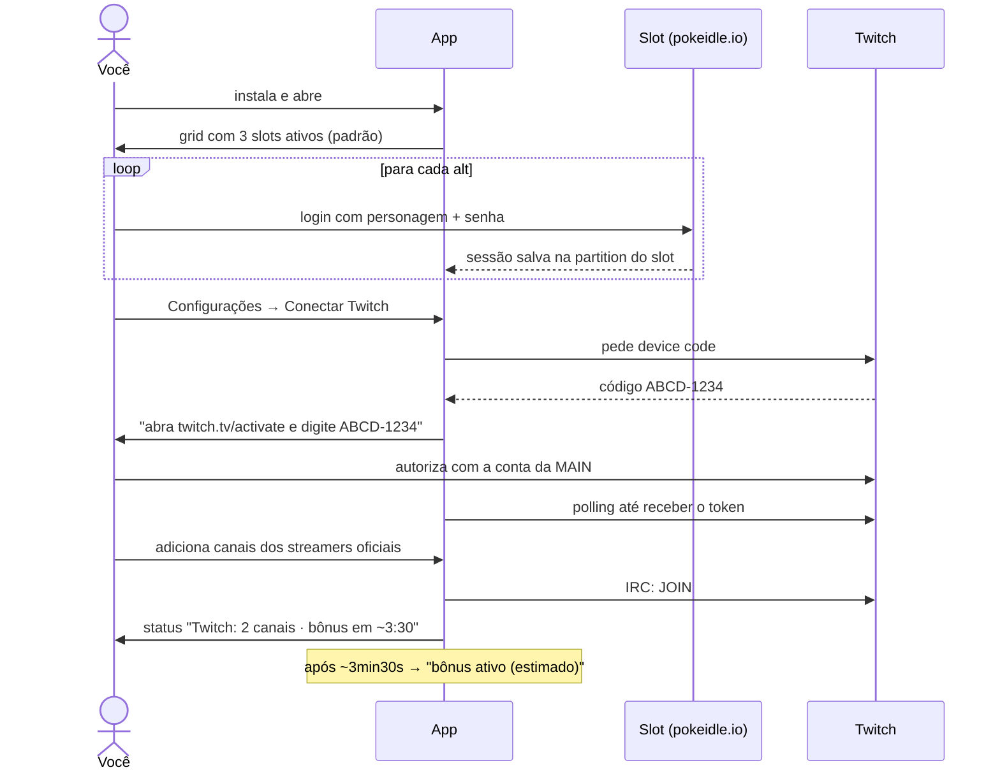
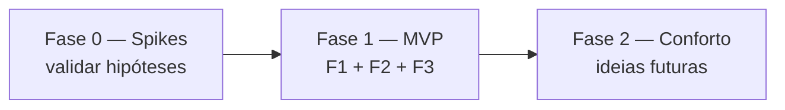

# Deck Chat — PRD

> App desktop pessoal (Windows) que junta várias contas do PokeIdle numa janela, no estilo IdleDeck, e mantém a conta principal presente nos chats da Twitch dos streamers oficiais, no estilo Chatterino, mas sem interface de chat.

| | |
|---|---|
| Status | Rascunho v2 — escopo fechado para o MVP |
| Dono | gbr |
| Plataforma alvo | Windows 10/11 (PC secundário). Desenvolvimento no Linux |
| Doc técnico | [TECHNICAL.md](./TECHNICAL.md) |
| Visual | [show-me-prd.html](./show-me-prd.html) |

---

## 1. Problema

Hoje, para deixar as alts do PokeIdle rodando e ainda ganhar o bônus de streamer na main, é preciso:

- abrir **um navegador ou perfil diferente por conta**, porque o login fica em cookie e localStorage e duas abas do mesmo navegador compartilham a sessão;
- manter **abas da Twitch abertas** só para a main "estar no chat". Isso consome um player de vídeo inteiro sem necessidade;
- lembrar de reabrir tudo quando o PC reinicia ou o navegador trava.

## 2. Objetivo

Um único app que:

1. Mostra **até 4 contas do PokeIdle ao mesmo tempo** num grid automático, cada uma com sessão isolada, como se estivesse num navegador diferente.
2. Mantém a **conta Twitch da main conectada ao chat** de uma lista de streamers da forma mais leve possível: sem vídeo, sem UI de chat, só presença.
3. Roda 24/7 de forma confiável: inicia com o Windows, fica na bandeja, reconecta e recarrega sozinho.

### Fatos confirmados

| Fato | Valor |
|---|---|
| URL do jogo | `https://pokeidle.io` |
| Tempo até o bônus ativar após entrar no chat | **~3min30s** com navegador normal · **3min40s** com IRC puro (S1, 26/10/2026, canal aXtLOL) |
| IRC sem vídeo conta como presença? | **Sim**, validado no S1 |
| Tempo até o bônus sumir após sair do chat | **< 5 min**, então a reconexão precisa ser rápida |
| Bônus de vários canais | **Acumula**: vale estar em todos os oficiais ao mesmo tempo |
| Bônus com o streamer offline | **Não conta**: só quando ele está ao vivo |
| Bônus depende da máquina/IP? | **Não**: o S1 rodou num notebook Linux e o bônus ativou no jogo aberto no PC Windows. É por conta |
| Tempo usado pelo app para "bônus ativo (estimado)" | **4:00** (folga sobre os 3:40 medidos) |
| Autorizar o app desloga a Twitch? | **Não**. No S1, o que derrubou a sessão web do PC Windows foi o **login novo no site** feito no notebook. O token do app não afeta sessões do navegador |
| Lista de streamers oficiais | **Enviada pelo servidor** no WebSocket (`estado.twitch.oficiais`, 16 canais em 28/10), junto com quem está ao vivo (`twitch.lives`). Não aparece na aba Network como requisição separada, por isso parecia fixa |

### Fora do escopo (decidido)

| Item | Motivo |
|---|---|
| **Kick** | O bônus da Kick é por pontos de canal ganhos **assistindo**, não por presença no chat. Você abre manualmente quando quiser |
| Ler ou enviar mensagens de chat | Não é o objetivo. A presença basta |
| Automação de gameplay (cliques, bots, macros) | Risco de ban. O app só **exibe** o jogo |
| Proxy ou IP por conta | O limite do jogo é 4 contas por IP, e o app respeita isso por design (máx. 4 slots) |
| Auto-update | O repo é privado, e auto-update exigiria um token embutido no app. As atualizações são manuais, baixando o `.exe` dos Releases |
| macOS e Linux como alvo | Só Windows. Linux é só ambiente de desenvolvimento |

## 3. Contexto de uso

```text
PC secundário (Windows)
  Deck Chat
    slot-1  alt A   (ativo)
    slot-2  alt B   (ativo)
    slot-3  alt C   (ativo)
    slot-4  —       (reservado; pode virar a main no futuro)
    TwitchPresence  → conta Twitch da MAIN em N canais
```

- As **contas do jogo** fazem login com **nome do personagem + senha**, direto no site, dentro do slot.
- A **conta Twitch** usada é sempre a da **main**, que é a vinculada no PokeIdle para receber o bônus.
- Hipótese de funcionamento do bônus: os streamers oficiais dão mod ao dev do PokeIdle, que consulta a lista de quem está conectado no chat (Twitch *Get Chatters*). Por isso a presença no chat deve bastar. **Isso precisa ser validado na Fase 0.**

## 4. Funcionalidades do MVP

### F1 — Slots de conta (grid automático)

| ID | Requisito |
|---|---|
| F1.1 | 4 slots fixos (`slot-1`…`slot-4`), cada um ativável e desativável nas configurações |
| F1.2 | Cada slot tem **sessão persistente e isolada** (cookies, localStorage, IndexedDB e cache separados) |
| F1.3 | Login feito no próprio site. Fechar e reabrir o app mantém o login |
| F1.4 | Grid automático conforme o número de slots ativos (1 → 1×1, 2 → 2×1, 3–4 → 2×2) |
| F1.5 | Cada slot tem um rótulo editável (ex.: "Alt A — Charizard") |
| F1.6 | Barra por slot com **mutar/desmutar**, **recarregar** e indicador de estado |
| F1.7 | O jogo **não desacelera** com a janela minimizada, na bandeja ou sem foco (throttling de segundo plano desativado) |
| F1.8 | Se a página do slot travar ou o processo cair, o app recarrega sozinho e registra o evento |
| F1.9 | URL do jogo configurável (padrão `https://pokeidle.io`) |
| F1.10 | Os slots **continuam rodando** enquanto a aba ou um modal de configurações estiver aberto |
| F1.11 | **Vigia de saúde**: o jogo é controlado pelo servidor e recebe ~60–90 mensagens/min por alt (S3). Se um slot ficar **3 min sem receber nada**, ele vai para o status `sem resposta` e é recarregado sozinho. A barra do slot mostra `eventos/min` |
| F1.12 | A barra de cada slot mostra os dados da alt vindos do jogo: **nick** (no lugar de "Alt A") e **nível e hunt atual** (`Nv 44 · charmander`). As pokébolas não aparecem na barra; são usadas só para o aviso "acabaram as pokébolas" (F5.2) |

### F2 — Presença na Twitch (main)

| ID | Requisito |
|---|---|
| F2.1 | Login da main via **Device Code Flow**: o app mostra um código e abre `twitch.tv/activate` **no navegador padrão do Windows**, onde você já está logado, e você só autoriza. **Nunca** abrir o login da Twitch numa janela própria do app: isso conta como dispositivo novo e pode derrubar a sessão do navegador (observado no S1) |
| F2.2 | Token salvo **criptografado** (DPAPI do Windows via `safeStorage`) e renovado automaticamente |
| F2.3 | **Lista de canais importada do jogo**: o servidor envia `estado.twitch.oficiais` a cada ~67s (S4). O app sincroniza sozinho e guarda a última lista na config, para o IRC já entrar nos canais ao abrir, antes dos slots carregarem. Também é possível adicionar **canais extras manuais** e desligar qualquer canal |
| F2.4 | Uma única conexão IRC (WebSocket) entra em todos os canais ativos. Nada de vídeo nem UI de chat |
| F2.5 | Reconexão automática **rápida**: o bônus some em < 5 min. Inclui PING próprio a cada 60s (sem PONG em 10s → reconecta), reconexão imediata ao voltar do sleep, backoff de no máximo 60s e reentrada nos canais |
| F2.6 | Estado por canal: `entrando` → `presente · bônus em 4:00` (contagem regressiva) → `bônus ativo (estimado)`, ou `erro`. O app não enxerga o bônus de fato, só estima pelo tempo desde o `JOIN` |
| F2.8 | Opção "impedir suspensão do Windows" enquanto o app estiver aberto (`powerSaveBlocker`) |
| F2.9 | **Detecção de ao vivo pelo próprio jogo**: `estado.twitch.lives` traz os oficiais ao vivo e o número de espectadores. Sem consultar a API da Twitch. O horário em que o canal aparece como ao vivo conta como "início da live" para o F2.10. Canais extras manuais aparecem como "ao vivo: desconhecido" |
| F2.10 | O bônus só conta ao vivo e **acumula** entre canais, então o app fica sempre no chat de todos os canais ativos (offline não custa nada). O bônus estimado de cada canal é `max(JOIN, início da live) + 4:00` |
| F2.11 | A barra superior resume o estado, por exemplo `Twitch: 3/7 ao vivo · 3 bônus`. Notificação no tray quando a conexão cai por mais de 30s |
| F2.7 | Botão "Sair da Twitch" (revoga e apaga o token) |

### F3 — Sistema e operação

| ID | Requisito |
|---|---|
| F3.1 | **Minimizar para a bandeja**: fechar a janela ou "minimizar" esconde o app em vez de encerrar. Menu do tray: Mostrar / Status / Sair. **A janela nunca fica no estado minimizado do Windows**, porque nele os slots caem para 1 fps (S3). O botão nativo de minimizar é desativado e substituído por "⤓ Bandeja" |
| F3.2 | **Iniciar com o Windows** (opção), podendo já iniciar escondido na bandeja |
| F3.3 | **Indicador de status** global na barra superior: Twitch (conectado, com nº de canais e bônus estimado) e slots (ok, recarregando, erro) |
| F3.4 | **Atualização manual**: a aba Sobre mostra a versão instalada. Para atualizar, baixe o novo instalador nos Releases do repo privado e rode-o por cima; as sessões e a config são preservadas |
| F3.5 | Janela lembra tamanho, posição e monitor |

### F5 — Notificações das alts

| ID | Requisito |
|---|---|
| F5.1 | **Aba "Notificações"**: linha do tempo única com os eventos de todas as alts, mostrando horário, alt, ícone do tipo e descrição |
| F5.2 | Tipos (formato confirmado no S4):<br>• **Shiny** capturado / fugiu (`capturado.pokemon.shiny`, `bola.shiny`, `fugiu.shiny`) e apareceu (hipótese: `spawn.looktype` 7xxxx), com destaque<br>• **Drop**: todo item de `morte.drops` (stones nas hunts normais; boss token, fragmentos e stones nas outlands). Sem lista de raros<br>• **Captura**: toda captura, com os dados do Pokémon (nome, nível, quality, potência, IVs). Sem filtro de raridade<br>• **Problemas**: sem pokébola (`estado.balls`), foi ao Centro Pokémon (`noCentro`/`centroMotivo`), sem resposta (F1.11) |
| F5.3 | Filtro por alt e por tipo |
| F5.4 | Fonte: leitura **passiva** das mensagens WebSocket que o servidor envia a cada slot (o mesmo canal do F1.11). Nada é enviado ao jogo |
| F5.5 | Histórico **só da sessão atual** (em memória). Fechar o app limpa a lista |
| F5.6 | Sem notificação do Windows: só a aba, com um contador de não lidas no título da aba |
| F5.7 | O formato das mensagens é descoberto no spike **S4**. O parser fica isolado (`src/main/game/`), porque pode quebrar quando o jogo atualizar. Mensagens não reconhecidas são ignoradas e registradas no log |

### F4 — Configurações

| ID | Requisito |
|---|---|
| F4.1 | **Aba "Configurações"** separada da aba "Contas", em tela cheia. Ao entrar nela, as views dos slots são escondidas, mas os jogos continuam rodando |
| F4.2 | **Modal rápido** para ações curtas (ex.: adicionar canal, renomear slot). Ao abrir, o app tira um print de cada slot, esconde as views e mostra os prints desfocados de fundo, com o modal por cima. Visualmente parece um overlay sobre os jogos |
| F4.3 | Fechar a aba ou o modal devolve os slots exatamente como estavam |

## 5. Fluxos principais

### 5.1 Primeiro uso



### 5.2 Operação diária

```text
Windows liga
  Deck Chat inicia escondido na bandeja
    restaura slots ativos     → as sessões já estão logadas
    valida/renova token Twitch
    conecta IRC → JOIN nos canais ativos
  você só abre a janela quando quiser olhar as contas
```

### 5.3 Atualização manual

```text
você faz git tag v0.2.0 && git push --tags
  GitHub Actions (windows-latest) gera Deck-Chat-Setup-0.2.0.exe
  publica num Release do próprio repo privado (GITHUB_TOKEN automático)
no PC Windows
  abre o Release no GitHub (logado) → baixa o .exe → instala por cima
  config, tokens e sessões dos slots ficam em %APPDATA% → nada se perde
```

## 6. Interface (wireframe)

```text
┌──────────────────────────────────────────────────────────────────────┐
│ Deck Chat  [Contas] [Configurações]  ● Twitch 3/7 ao vivo · 3 bônus  │
├───────────────────────────────────┬──────────────────────────────────┤
│ Alt A            🔊 ⟳  ● ok       │ Alt B            🔇 ⟳  ● ok      │
│                                   │                                  │
│          [ pokeidle.io ]          │          [ pokeidle.io ]         │
│                                   │                                  │
├───────────────────────────────────┼──────────────────────────────────┤
│ Alt C            🔇 ⟳  ● ok       │ Slot 4 — desativado              │
│                                   │                                  │
│          [ pokeidle.io ]          │      [ + ativar slot ]           │
│                                   │                                  │
└───────────────────────────────────┴──────────────────────────────────┘
```

A aba **Configurações** ocupa a tela inteira (os slots ficam escondidos, mas rodando):

```text
Configurações
├── Slots        # ativar/desativar, rótulo, URL do jogo, limpar sessão do slot
├── Twitch       # conectar/desconectar main, lista de canais (+ toggle), status por canal
├── Sistema      # iniciar com Windows, iniciar escondido, fechar → bandeja
└── Sobre        # versão instalada, link para os Releases, abrir pasta de logs
```

Já o **modal rápido** aparece sobre a aba Contas, com os prints desfocados dos slots de fundo:

```text
┌──────────────────────────────────────────────────────────────────────┐
│ ░░░░░░░░ print desfocado ░░░░░░░░ │ ░░░░░░░░ print desfocado ░░░░░░░ │
│ ░░░░░░░ ┌──────────────────────────────────────────┐ ░░░░░░░░░░░░░░ │
│ ░░░░░░░ │ Adicionar canal Twitch                   │ ░░░░░░░░░░░░░░ │
│ ░░░░░░░ │ [ streamer_oficial_3        ]  [Salvar]  │ ░░░░░░░░░░░░░░ │
│ ░░░░░░░ └──────────────────────────────────────────┘ ░░░░░░░░░░░░░░ │
│ ░░░░░░░░░░░░░░░░░░░░░░░░░░░░░░░░░ │ ░░░░░░░░░░░░░░░░░░░░░░░░░░░░░░░░ │
└──────────────────────────────────────────────────────────────────────┘
```

## 7. Requisitos não funcionais

| Área | Requisito |
|---|---|
| Confiabilidade | Rodar dias seguidos sem intervenção. Reconexão do IRC e recarga dos slots automáticas |
| Desempenho | A presença na Twitch deve custar ~0 (1 WebSocket). O custo do app é dominado pelos slots (~200–400 MB de RAM cada, estimado) |
| Segurança | Slots sem acesso a Node, `contextIsolation` + `sandbox`. Token criptografado. IPC validado com schemas |
| Privacidade | Nenhuma telemetria. Logs só locais |
| Distribuição | Instalador `.exe` (NSIS) gerado pelo GitHub Actions e publicado nos Releases do próprio repo privado. Atualização manual |

## 8. Roadmap



### Fase 0 — Validação (antes de construir a UI)

| Spike | Pergunta | Critério de sucesso |
|---|---|---|
| S1 — Presença IRC ✅ | Uma conexão IRC autenticada (sem vídeo) ativa o bônus de streamer na main? | **Validado em 26/10/2026**: o bônus ativou em 3:40 após o `JOIN`, com 0 reconexões. Ao parar o script, o bônus demorou um pouco para sumir. Ver `spikes/s1-twitch-presence/README.md` |
| S2 — Slot isolado ✅ | O pokeidle.io funciona dentro do Electron com partitions separadas? (login, sem bloqueio de Cloudflare/UA) | **Validado em 27/10/2026** no Windows: 3 alts logadas, sessões mantidas após reiniciar, slot 4 isolado, ~715 MB de RAM com 3 slots |
| S3 — Segundo plano ✅ | Com o throttling desativado, o jogo continua progredindo com o app minimizado ou na bandeja? | **Validado em 27/10/2026.** Rodada 1: minimizada → 1 fps, então o minimizar nativo foi trocado por "esconder na bandeja". Rodada 2: sem foco, bandeja e coberta tiveram fps, timers e atividade de rede iguais, e o "tempo para upar" caiu em ritmo constante. O jogo é controlado pelo servidor (cliente envia ~2.4 msgs/min). Ver `spikes/s2-s3-slots/README.md` |
| S4 — Eventos do jogo ✅ | Como o servidor descreve drops, shinies, capturas e problemas nas mensagens WebSocket? | **Validado em 28/10/2026**: JSON texto com tipo em `t` (`batalha`, `estado`, `chat`, `shiny.captura`…). Drops, capturas, shiny e munição mapeados. **Bônus:** o jogo envia a lista oficial de streamers e quem está ao vivo. Ver `spikes/s4-ws-events/README.md` |

> Se o S1 falhar, o plano B é carregar o popout de chat oficial (`twitch.tv/popout/<canal>/chat`) numa partition escondida da main. É mais pesado, mas igual a um navegador.

### Fase 1 — MVP

Ordem sugerida: ~~casca Electron + Svelte → slots (F1)~~ (feito na Fase 0) → ~~limpar os spikes + vigia de saúde (F1.11, F1.12)~~ (v0.0.4) → ~~aba/modal de configurações (F4)~~ (v0.0.5) → ~~Twitch (F2)~~ (v0.0.6) → ~~Notificações (F5)~~ (v0.0.7) → tray/auto-start/status (F3) → CI gerando o `.exe` nos Releases.

### Fase 2 — Ideias futuras (não comprometidas)

- Usar o slot 4 para a main.
- Modo "foco": duplo clique maximiza um slot e esconde os outros.
- Zoom por slot, para caber melhor no grid.
- Reavaliar a Kick se o PokeIdle mudar o método de bônus.
- Aviso de "nova versão disponível" ou auto-update, caso o repo vire público.

## 9. Critérios de aceite do MVP

- [ ] 3 alts logadas ao mesmo tempo, cada uma com sessão própria, e o login continua após reiniciar o PC.
- [ ] Ativar o slot 4 reorganiza o grid para 2×2 sem reiniciar.
- [ ] Mutar e recarregar funcionam por slot.
- [ ] O jogo continua progredindo com o app na bandeja.
- [ ] A main fica presente em todos os canais ativos e o **bônus aparece no jogo** em ~4 min.
- [ ] O status mostra corretamente quais canais estão ao vivo e quantos bônus estão ativos (estimado).
- [ ] Desligar o Wi-Fi por 30s: o app reconecta em segundos, e o bônus não chega a sumir no jogo.
- [ ] Derrubar a rede por 1 min faz o IRC reconectar e reentrar nos canais sozinho.
- [ ] O app inicia com o Windows, já na bandeja.
- [ ] Abrir a aba ou o modal de configurações não interrompe o progresso dos slots.
- [ ] Uma nova tag `v*` gera o instalador nos Releases, e instalar por cima mantém logins e config.
- [ ] Um slot que para de receber eventos do servidor por 3 min é recarregado sozinho.
- [ ] A aba Notificações mostra shinies, itens raros, capturas raras e problemas das alts, com horário e alt, e permite filtrar.

## 10. Riscos

| Risco | Impacto | Mitigação |
|---|---|---|
| IRC "puro" não contar como presença | Alto | Spike S1 primeiro. Plano B: popout de chat escondido |
| Twitch mudar ou limitar o IRC | Médio | Isolado no módulo `twitch/`. O plano B continua válido |
| PokeIdle bloquear o Electron (UA/Cloudflare) | Médio | Usar o user-agent do Chrome equivalente. Spike S2 |
| Consumo de RAM com 4 slots no PC secundário | Médio | Medir no S2. Desativar slots não usados |
| SmartScreen avisar sobre o `.exe` sem assinatura | Baixo | Aceitável para uso pessoal ("Executar assim mesmo") |
| `capturePage()` lento com 4 slots grandes | Baixo | Capturas em paralelo. Se demorar, abrir o modal sobre um fundo escuro simples |
| Formato das mensagens do jogo mudar numa atualização | Médio | Parser isolado e tolerante: mensagens desconhecidas são ignoradas e logadas. As notificações param, mas o resto do app segue |
| Mensagens em formato binário (msgpack/protobuf) | Médio | Descobrir no S4. Se forem binárias, decodificar com a lib correspondente |
| Regras do jogo sobre clientes de terceiros | Médio | O app não automatiza nada e respeita o limite de 4 contas por IP |

## 11. Questões em aberto

- ~~URL do jogo~~ → `https://pokeidle.io`.
- ~~Tempo até o bônus~~ → ~3min30s (navegador). Confirmar o mesmo tempo via IRC no S1.
- ~~Distribuição~~ → repo único privado `deck-chat`, Releases privados, update manual.
