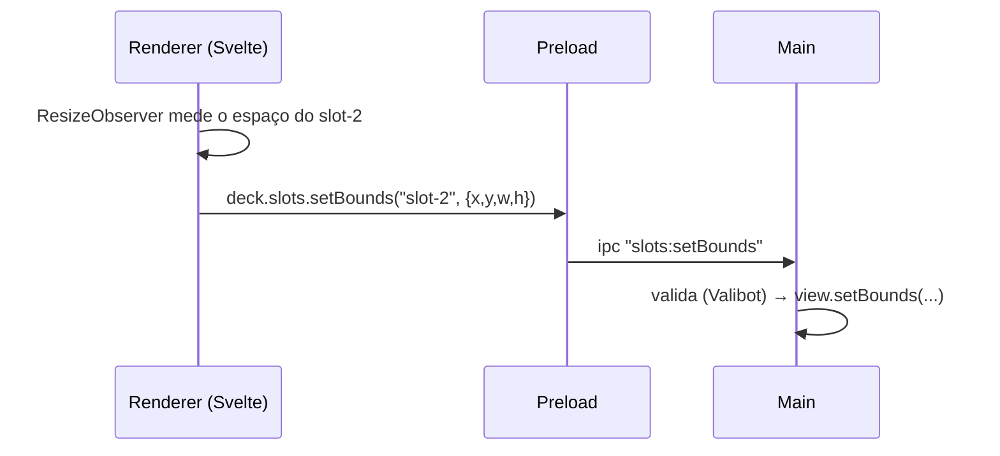
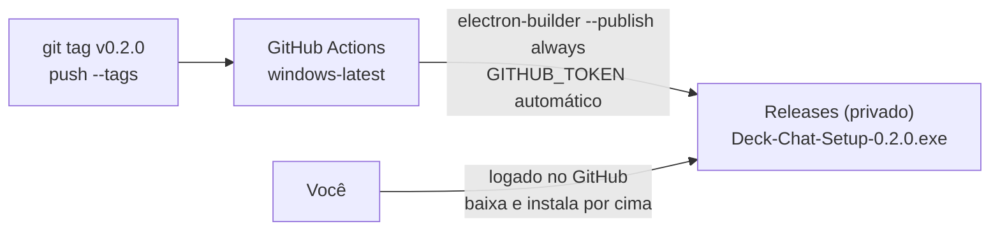

# Deck Chat — Decisões técnicas

Complemento do [PRD](./PRD.md). Explica **o que** vamos usar, **por quê** e **como o projeto se organiza**. Tem também uma seção de Svelte para quem vem do Angular.

---

## 1. Resumo da stack

| Camada | Escolha |
|---|---|
| Runtime desktop | **Electron** (versão estável atual) |
| Linguagem | **TypeScript** em tudo (main, preload, renderer) |
| UI | **Svelte 5** (runes), sem SvelteKit |
| Build/dev | **electron-vite** (Vite para main, preload e renderer) |
| Validação | **Valibot**, só nas fronteiras (config, IPC, respostas da Twitch) |
| Empacotamento | **electron-builder** → instalador NSIS para Windows |
| Atualização | **Manual**: o `.exe` fica nos Releases do repo privado (sem electron-updater) |
| Testes | **Vitest** (lógica pura: parser IRC, layout, schemas) |
| Qualidade | ESLint + Prettier + `svelte-check` |
| Gerenciador de pacotes | **npm**, por ter menos atrito com electron-builder no Windows |
| CI | GitHub Actions (`windows-latest`) |

---

## 2. Registro de decisões (ADRs)

### ADR-001 — Electron em vez de Tauri ou Qt

**Decisão:** Electron.

**Por quê:** o requisito central é ter **várias sessões de navegador isoladas na mesma janela**. O Electron resolve isso nativamente com `session.fromPartition('persist:slot-1')`: cada partition tem cookies, storage e cache próprios, e o prefixo `persist:` salva tudo em disco.

| Alternativa | Por que não |
|---|---|
| Tauri (WebView2) | Vários perfis isolados de WebView2 no mesmo app são frágeis e mal suportados. Dá para fazer, mas brigando com a plataforma |
| Qt / C++ (como o Chatterino) | `QWebEngineProfile` funciona, mas o esforço é muito maior e o objetivo é aprender Svelte, não C++ |

**Custo aceito:** binário de ~100 MB e RAM maior. Num app pessoal de uso contínuo, tudo bem.

### ADR-002 — `WebContentsView` em vez da tag `<webview>`

**Decisão:** cada slot é um `WebContentsView` criado e gerenciado pelo **processo principal**.

**Por quê:** a tag `<webview>` é desaconselhada pela própria equipe do Electron (instável, com problemas de segurança e foco). O `WebContentsView` é a API atual.

**Consequência importante:** **as páginas do jogo não são componentes Svelte.** O Svelte desenha só a "moldura" (barras, botões, espaços reservados), e o main posiciona as views nativas **por cima** desses espaços.



Isso também significa que **modais e menus do Svelte não conseguem ficar sobre os slots**, porque a view nativa sempre fica por cima. A solução está no ADR-009.

### ADR-009 — Configurações: aba dedicada + modal com "foto" dos slots

**Decisão:** dois modos, ambos baseados em **esconder as views** (os jogos continuam rodando, porque o `backgroundThrottling` está desligado).

```text
aba Configurações (tela cheia)
  ao entrar: slots.setVisible(false)
  ao sair:   slots.setVisible(true)

modal rápido (sobre a aba Contas)
  abrir()
    fotos = await Promise.all(slots.map(s => s.webContents.capturePage()))
    envia fotos (dataURL) para a UI
    slots.setVisible(false)
    UI desenha as fotos nos mesmos lugares, com blur, e o modal por cima
  fechar()
    slots.setVisible(true)
    UI descarta as fotos
```

| Alternativa | Por que não (por ora) |
|---|---|
| View de overlay transparente no topo | Overlay real sobre os jogos ao vivo, mas exige um segundo renderer e estado sincronizado via main |
| Janela filha modal (`BrowserWindow` com `parent`) | Problemas de foco, posição e multi-monitor. Parece "outra janela" |

Os dois caminhos continuam possíveis no futuro sem mudar o resto da arquitetura.

### ADR-003 — Svelte 5 puro + Vite (sem SvelteKit)

**Decisão:** Svelte 5 com runes, via `electron-vite`.

**Por quê:** o SvelteKit é um framework de app web (rotas, SSR, servidor), equivalente ao Next ou Angular SSR. No Electron não há servidor nem SEO, e só existe uma tela, então ele só atrapalharia. "Rotas" aqui são só um `$state` com a aba ativa.

### ADR-004 — Valibot nas fronteiras (e só nelas)

**Decisão:** schemas Valibot em `src/shared/schemas.ts`, usados para:

```text
dado externo                         onde valida
  config.json lido do disco            main/store.ts (ao carregar)
  argumentos de toda chamada IPC       main/ipc.ts (antes do handler)
  respostas OAuth da Twitch            main/twitch/auth.ts
```

**Por quê:** o TypeScript só existe em tempo de compilação. Um arquivo de config corrompido ou de versão antiga, ou um payload IPC inesperado, passa direto pelos tipos. Valibot e Zod resolvem o mesmo problema; escolhemos o **Valibot** por ser modular (tree-shaking, bundle bem menor) e ter API funcional com `pipe`.

**O que não validar:** estado interno da UI e chamadas entre funções do próprio código. Ali o TypeScript basta.

**Svelte precisa de Zod/Valibot?** Não. São bibliotecas independentes de framework. Usamos por causa do Electron (disco + IPC), não por causa do Svelte.

### ADR-005 — Presença na Twitch via IRC headless + Device Code Flow

**Decisão:** um serviço no main abre **um** WebSocket para `wss://irc-ws.chat.twitch.tv:443`, autentica com a conta da main e dá `JOIN` em todos os canais da lista. Não há UI de chat; as mensagens recebidas são descartadas.

**OAuth:** **Device Code Flow** com um app registrado no dev.twitch.tv como *Public client*.
- Não precisa de servidor nem de redirect funcional, e nenhum segredo fica embutido no app.
- Scope mínimo: `chat:read`.

```text
login()
  POST id.twitch.tv/oauth2/device {client_id, scopes: "chat:read"}
    → device_code, user_code, verification_uri, interval
  mostra user_code e abre verification_uri com shell.openExternal   # navegador padrão, onde já há sessão
  # NUNCA abrir numa BrowserWindow/WebContentsView própria: sem cookies → login novo
  # → "dispositivo novo" → a Twitch pode derrubar a sessão web (visto no S1)
  a cada `interval` s:
    POST id.twitch.tv/oauth2/token {grant_type: device_code, device_code}
      authorization_pending → continua
      sucesso → {access_token, refresh_token}
  salva tokens com safeStorage
  GET id.twitch.tv/oauth2/validate → descobre o login (nick) da main

manutenção do token
  ao iniciar e a cada 1h: /oauth2/validate      # a Twitch exige validação periódica
  se expirado: refresh                          # em client público o refresh_token é de uso único → salvar o novo
  se o refresh falhar: status "reautenticar" e notificação no tray
```

```text
TwitchPresence.connect()
  ws = WebSocket(wss://irc-ws.chat.twitch.tv:443)
  send "PASS oauth:<token>"
  send "NICK <login>"
  em lotes que respeitem o rate limit de JOIN:
    send "JOIN #canal1,#canal2,..."
  on "PING :tmi.twitch.tv"  → send "PONG :tmi.twitch.tv"
  on JOIN/ROOMSTATE próprio → canal = "presente", joinedAt = agora
  status derivado: agora - joinedAt ≥ 4m → "bônus ativo (estimado)"   # medido: 3m40s
  on "RECONNECT" ou close   → reconectar com backoff (1s, 2s, 4s… máx 60s)
  on "NOTICE … Login authentication failed" → refresh do token → reconectar
  keepalive: a cada 60s envia "PING :deck-chat"; sem PONG em 10s → forçar reconexão
  powerMonitor "resume" → reconectar imediatamente
```

```text
OfficialChannels (alimentado pelo GameState dos slots, sem chamar a API da Twitch)
  estado.twitch.oficiais (~a cada 67s, S4) → lista oficial; salva na config (cache)
  canais = oficiais ∪ extras manuais − desligados
  mudou a lista → TwitchPresence entra/sai dos canais (JOIN/PART)
  estado.twitch.lives → ao vivo = { espectadores, visto ao vivo desde }
  bônus estimado do canal = ao vivo && agora ≥ max(joinedAt, aoVivoDesde) + 4m
  resumo: "3/16 ao vivo · 3 bônus"
```

Por que não a Helix (*Get Streams*): o jogo já envia a mesma informação e define o que conta como "oficial". Uma fonte a menos para manter.

O IRC fica conectado a **todos** os canais ativos o tempo todo, inclusive os offline, porque o bônus acumula entre canais e entrar só quando a live começa não traria vantagem.

O bônus some em **menos de 5 min** fora do chat, então toda queda precisa ser detectada e resolvida em segundos. Por isso usamos um keepalive próprio em vez de esperar o PING da Twitch (~5 min).

**Status:** ✅ validado no spike S1 (bônus ativo em 3:40 após o `JOIN`). Implementação de referência em `spikes/s1-twitch-presence/presence.ts`.

**Plano B (descartado, mantido para referência):** carregar `twitch.tv/popout/<canal>/chat` numa `WebContentsView` escondida, com partition `persist:main-twitch`. É mais pesado, mas igual a um navegador.

### ADR-006 — Persistência: JSON validado + token criptografado

**Decisão:**
- **Config:** `userData/config.json`, lida e escrita por um wrapper próprio pequeno, validada com Valibot e com campo `version` para migrações.
- **Tokens:** `userData/twitch.bin`, criptografado com `safeStorage.encryptString` (DPAPI no Windows, ligado ao usuário do Windows).
- **Sessões do jogo:** gerenciadas pelo próprio Chromium dentro das partitions (`userData/Partitions/slot-N`).

Usamos um wrapper próprio em vez de `electron-store` porque é pouco código, dá controle sobre o schema e as migrações, e é bom para aprender.

### ADR-007 — Segurança do Electron

Duas regras separam a UI própria do jogo:

```text
janela principal (renderer Svelte)
  contextIsolation: true, sandbox: true, nodeIntegration: false
  só acessa o main via window.deck (preload) → API mínima e tipada

views dos slots (pokeidle.io)
  contextIsolation: true, sandbox: true, nodeIntegration: false
  sem preload            # o jogo não enxerga nada do app
  backgroundThrottling: false
  setWindowOpenHandler → links externos abrem no navegador padrão
  will-navigate → só permite navegar dentro do domínio do jogo
```

### ADR-008 — Distribuição: repo único privado + update manual

**Decisão:** um único repo **privado** `deck-chat`. O CI publica o instalador nos **Releases desse mesmo repo**, e você baixa e instala manualmente.

**Por quê:** os Releases herdam a visibilidade do repo. Num repo privado, baixar o `.exe` exige autenticação, então o auto-update precisaria de um token embutido no app. O GitHub Packages não é alternativa, porque serve para npm/Docker/NuGet e não para `.exe`. O update manual elimina tokens e o segundo repo.



- Nenhum PAT: o workflow usa o `GITHUB_TOKEN` automático com `permissions: contents: write`.
- Instalar por cima preserva tudo, porque config, tokens e partitions ficam em `%APPDATA%\Deck Chat`.
- Se o repo virar público, dá para ligar o `electron-updater` depois com poucas linhas (provider `github`), sem token.
- O `.exe` não é assinado, então o SmartScreen vai avisar na instalação. Aceitável para uso pessoal.

---

## 3. Estrutura do projeto

```text
deck-chat/
├── src/
│   ├── main/                     # processo principal (Node)
│   │   ├── index.ts              # bootstrap: single-instance lock, janela, wiring
│   │   ├── window.ts             # BaseWindow + view da UI, posição/tamanho salvos
│   │   ├── ipc.ts                # registra handlers IPC (com validação Valibot)
│   │   ├── logger.ts             # deck.log + CSVs em userData/logs
│   │   ├── store.ts              # config.json + migrações
│   │   ├── secrets.ts            # safeStorage para os tokens
│   │   ├── tray.ts               # ícone, menu, fechar → bandeja
│   │   ├── autostart.ts          # setLoginItemSettings
│   │   ├── slots/
│   │   │   ├── SlotManager.ts    # cria/destroi views, bounds, mute, reload, crash, visibilidade, capturePage
│   │   │   ├── policy.ts         # navegação permitida, popups about:blank, window open handler
│   │   │   └── GameTap.ts        # DevTools Protocol: lê os frames WS do slot → GameState, eventos, vigia de saúde
│   │   ├── game/
│   │   │   ├── messages.ts       # schemas Valibot das mensagens do jogo (batalha, estado, shiny.captura); tolerantes
│   │   │   ├── GameState.ts      # junta os "estado" parciais por slot: nick, nível, hunt, bolas, twitch…
│   │   │   ├── events.ts         # EventDraft (evento sem id/horário/slot)
│   │   │   ├── parser.ts         # mensagem → evento (shiny, drop, captura, problema); puro e testável
│   │   │   └── EventFeed.ts      # feed em memória da sessão, filtros, contador de não lidas
│   │   └── twitch/
│   │       ├── auth.ts           # Device Code Flow, validate, refresh
│   │       ├── irc.ts            # parser de linhas IRC (puro, testável)
│   │       ├── TwitchPresence.ts # conexão, JOIN, keepalive, reconexão, estados
│   │       ├── OfficialChannels.ts # lista oficial + ao vivo vindos do jogo, extras manuais
│   │       └── bonus.ts          # cálculo puro do bônus estimado por canal
│   ├── preload/
│   │   └── index.ts              # contextBridge.exposeInMainWorld('deck', …)
│   ├── renderer/                 # UI Svelte
│   │   ├── index.html
│   │   └── src/
│   │       ├── main.ts           # mount(App)
│   │       ├── App.svelte        # alterna aba Contas | Configurações
│   │       ├── lib/
│   │       │   ├── state/        # *.svelte.ts: estado global com runes
│   │       │   │   ├── config.svelte.ts
│   │       │   │   └── status.svelte.ts
│   │       │   └── layout.ts     # cálculo do grid (puro, testável)
│   │       └── components/
│   │           ├── TopBar.svelte
│   │           ├── SlotGrid.svelte
│   │           ├── SlotFrame.svelte
│   │           ├── StatusPill.svelte
│   │           ├── QuickModal.svelte     # modal sobre as fotos desfocadas dos slots
│   │           └── settings/
│   │               ├── SettingsPage.svelte   # aba em tela cheia
│   │               ├── SlotsSection.svelte
│   │               ├── TwitchSection.svelte
│   │               └── SystemSection.svelte
│   └── shared/                   # importado por main, preload e renderer
│       ├── schemas.ts            # schemas Valibot + tipos inferidos
│       └── ipc.ts                # contrato IPC (nomes de canais + tipos)
├── resources/                    # ícones (.ico, tray)
├── tests/                        # Vitest
├── .github/workflows/release.yml
├── electron.vite.config.ts
├── electron-builder.yml
├── package.json
└── docs/
```

**Regra de dependência:** `renderer` → (via `window.deck`) → `preload` → `main`. O `shared` pode ser importado por todos, mas não importa nenhum deles.

---

## 4. Contrato IPC

| Canal | Direção | Payload | Uso |
|---|---|---|---|
| `config:get` | UI → main | — | Carrega a config |
| `config:update` | UI → main | `Partial<Config>` | Salva alterações |
| `slots:setBounds` | UI → main | `{ id, x, y, width, height }` | Posiciona a view |
| `slots:setMuted` | UI → main | `{ id, muted }` | Muta ou desmuta |
| `slots:reload` | UI → main | `{ id }` | Recarrega |
| `slots:clearSession` | UI → main | `{ id }` | "Deslogar" o slot |
| `slots:setVisible` | UI → main | `{ visible }` | Esconde ou mostra as views (aba de configurações / modal) |
| `slots:capture` | UI → main | — | Retorna `{ id, dataUrl, bounds }[]` para o fundo do modal |
| `twitch:login` | UI → main | — | Inicia o Device Code Flow |
| `twitch:logout` | UI → main | — | Revoga e apaga o token |
| `status:changed` | main → UI | `AppStatus` | Push de estado (slots + Twitch + update) |
| `twitch:deviceCode` | main → UI | `{ userCode, verificationUri }` | Mostra o código para autorizar |

---

## 5. Trechos de referência

### 5.1 Schemas (Valibot)

```ts
// src/shared/schemas.ts
import * as v from 'valibot'

export const SlotId = v.picklist(['slot-1', 'slot-2', 'slot-3', 'slot-4'])

export const SlotSchema = v.object({
  id: SlotId,
  label: v.pipe(v.string(), v.trim(), v.maxLength(32)),
  enabled: v.boolean(),
  muted: v.boolean(),
})

export const TwitchChannel = v.pipe(
  v.string(),
  v.trim(),
  v.toLowerCase(),
  v.regex(/^[a-z0-9_]{3,25}$/, 'nome de canal inválido'),
)

export const ConfigSchema = v.object({
  version: v.literal(1),
  gameUrl: v.pipe(v.string(), v.url()),
  slots: v.pipe(v.array(SlotSchema), v.length(4)),
  twitch: v.object({
    channels: v.array(v.object({ name: TwitchChannel, enabled: v.boolean() })),
  }),
  system: v.object({
    startWithWindows: v.boolean(),
    startHidden: v.boolean(),
    closeToTray: v.boolean(),
  }),
})

export type Config = v.InferOutput<typeof ConfigSchema>
export type Slot = v.InferOutput<typeof SlotSchema>
```

### 5.2 Criação de um slot (main)

```ts
// src/main/slots/SlotManager.ts (trecho)
const view = new WebContentsView({
  webPreferences: {
    partition: `persist:${slot.id}`,
    contextIsolation: true,
    sandbox: true,
    nodeIntegration: false,
    backgroundThrottling: false,
  },
})
view.webContents.setAudioMuted(slot.muted)
view.webContents.on('render-process-gone', () => this.scheduleReload(slot.id))
win.contentView.addChildView(view)
await view.webContents.loadURL(config.gameUrl)
```

### 5.3 Layout do grid (puro)

```text
gridFor(n slots ativos)
  n = 1  → 1 coluna × 1 linha
  n = 2  → 2 colunas × 1 linha
  n ≥ 3  → 2 colunas × 2 linhas  (célula vazia vira "+ ativar slot")
```

---

## 6. Svelte 5 para quem vem do Angular

### 6.1 Equivalências

| Angular | Svelte 5 | Nota |
|---|---|---|
| `count = signal(0)` | `let count = $state(0)` | Variável comum: atribuir já é reativo (`count++`) |
| `computed(() => a() * 2)` | `let dobro = $derived(a * 2)` | Sem `()` para ler |
| `effect(() => …)` | `$effect(() => { …; return cleanup })` | O cleanup substitui o `ngOnDestroy` |
| `input()` / `@Input()` | `let { slot } = $props()` | Props tipadas por desestruturação |
| `output()` / `@Output()` | prop de callback: `onreload` | Sem EventEmitter, só funções |
| `[(ngModel)]` | `bind:value={nome}` | |
| `@if` / `@for` | `{#if}` / `{#each items as item (item.id)}` | `(item.id)` é o `track` |
| `<ng-content>` | `{@render children()}` (snippets) | |
| `@ViewChild` | `bind:this={el}` | |
| `(click)="f()"` | `onclick={f}` | Atributo normal do DOM |
| Service + DI | módulo `.svelte.ts` exportando estado | Não existe DI: é só `import` |
| CSS do componente | `<style>` no `.svelte` | Já vem com escopo por padrão |

### 6.2 Exemplo: `SlotFrame.svelte`

```svelte
<script lang="ts">
  import type { Slot } from '../../../shared/schemas'

  let { slot, status }: { slot: Slot; status: 'ok' | 'loading' | 'error' } = $props()

  let area: HTMLDivElement

  // reporta ao main onde a view nativa deve ficar
  $effect(() => {
    const ro = new ResizeObserver(() => {
      const r = area.getBoundingClientRect()
      window.deck.slots.setBounds(slot.id, { x: r.x, y: r.y, width: r.width, height: r.height })
    })
    ro.observe(area)
    return () => ro.disconnect()
  })
</script>

<section class="frame">
  <header>
    <span>{slot.label}</span>
    <button onclick={() => window.deck.slots.setMuted(slot.id, !slot.muted)}>
      {slot.muted ? '🔇' : '🔊'}
    </button>
    <button onclick={() => window.deck.slots.reload(slot.id)}>⟳</button>
    <span class="dot {status}"></span>
  </header>
  <div class="area" bind:this={area}></div>
</section>

<style>
  .frame { display: grid; grid-template-rows: auto 1fr; min-height: 0; }
  .area  { min-height: 0; } /* a WebContentsView é desenhada aqui por cima */
</style>
```

### 6.3 Estado global (o "service" do Svelte)

```ts
// src/renderer/src/lib/state/status.svelte.ts
import type { AppStatus } from '../../../../shared/ipc'

export const status = $state<AppStatus>({ twitch: { state: 'offline', channels: [] }, slots: {} })

window.deck.onStatus((next) => Object.assign(status, next))
```

Qualquer componente que fizer `import { status }` reage automaticamente às mudanças, sem DI e sem `subscribe`.

---

## 7. Scripts e CI

```text
npm run dev         # electron-vite dev (hot reload no renderer)
npm run typecheck   # tsc + svelte-check
npm run test        # vitest
npm run build       # electron-vite build
npm run dist:win    # electron-builder --win (local, para testar)
```

```text
.github/workflows/release.yml
  on: push tags v*
  permissions: contents: write
  runs-on: windows-latest
  steps
    checkout → setup-node (LTS) → npm ci
    npm run typecheck && npm run test
    npm run build
    npx electron-builder --win --publish always
      env GH_TOKEN = secrets.GITHUB_TOKEN     # automático, nada para configurar
```

```yaml
# electron-builder.yml (trecho)
appId: dev.gbr.deckchat
productName: Deck Chat
win:
  target: nsis
nsis:
  oneClick: false
  allowToChangeInstallationDirectory: true
publish:
  provider: github
  owner: <seu-usuario>
  repo: deck-chat
  releaseType: release
```
